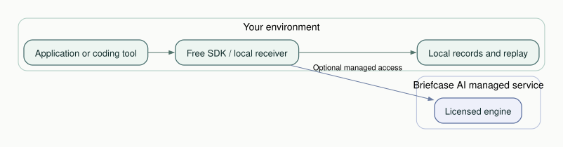

# Managed engine access

The proprietary engine runs in infrastructure operated by Briefcase. Contact your workspace administrator for an entitlement and the service endpoint. The portal is the place to request access. The gRPC client accepts the endpoint supplied for your workspace. [Managed engine portal](https://observe.briefcasebrain.io/engine)

## Connect an entitled workspace

Install the independent gRPC client with `pip install 'briefcase-ai[engine]'`. Set `BRIEFCASE_ENGINE_ADDR` to the TLS endpoint provided for your workspace, load `OCI_JJ_AUTH_TOKEN` through your secret manager, and set `OCI_JJ_TLS_CA` if your administrator supplies a CA. Run `briefcase-ai graph log <ref>` with a repository reference you can access. The portal URL above serves a web page; your workspace endpoint serves gRPC.

## Use the free SDK locally

Capture decisions with `briefcase.observe("runs.jsonl")`, inspect the resulting file, or run a local OTLP receiver with `briefcase-ai receive`. These workflows require no paid engine or hosted account.

## Migrate an existing installation

1. Run `briefcase-ai engine status --json` to identify a legacy installation. Keep the output private. Existing data stays on the machine when you update the SDK.
2. Contact the workspace administrator through the portal. Arrange a backup and a migration plan before stopping the old service. Confirm that required records are accessible in the managed workspace. The SDK does not transfer legacy volumes.
3. Preview the shutdown with `briefcase-ai engine down --dry-run`. When ready, run `briefcase-ai engine down`. Its default preserves data volumes.
4. Preview removal with `briefcase-ai engine uninstall --dry-run`. Ordinary uninstall retains data volumes and secrets. The separate `--purge` option permanently removes eligible data after confirmation.

Use `briefcase-ai engine logs` and `briefcase-ai engine doctor` to inspect an existing installation during migration. The SDK accepts no customer installation, startup or upgrade commands for the proprietary engine.
